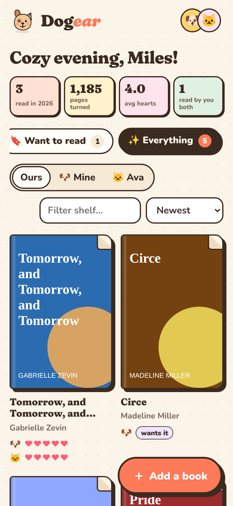
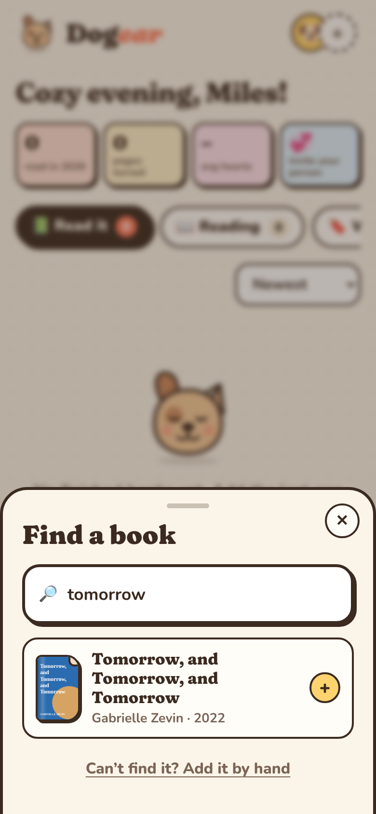
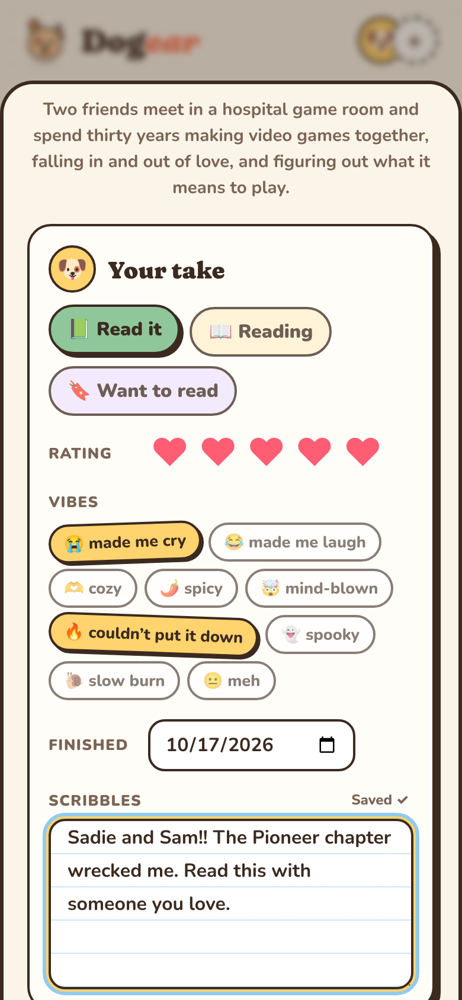

# 🐶 Dogear

A cozy little shelf for the books you read together.

Dogear keeps track of every book you've read, how much you loved it (in hearts),
the vibes it gave you, and your scribbles about it. Share one shelf with your
person and you'll each see the other's ratings and notes.

<p>
  
  
  
</p>

- **Find any book**: type a title, author or ISBN and Dogear fetches the cover,
  author, year, page count and blurb from [Open Library](https://openlibrary.org)
  (falling back to Google Books). No API key needed. Can't find it? Add it by hand.
- **Your take, their take**: each of you marks a book as *Read it*, *Reading* or
  *Want to read*, gives it up to 5 hearts, picks vibes (😭 🫶 🌶️ 🤯 …) and writes
  scribbles. Their take shows right under yours.
- **Shared shelf**: one invite link and you're both on the same shelf, synced
  across phones and computers. Filter by *Ours*, *Mine* or theirs.
- **Works offline** and installs like a real app on Android and iPhone.
- **Backup** your whole shelf to a file any time.

## Using it

### On the web

Every push to `main` publishes the app to GitHub Pages at
`https://<owner>.github.io/BookTracker/`.

One-time setup: in the repo go to **Settings → Pages** and set **Source** to
**GitHub Actions**.

### On Android

Two ways, pick whichever:

1. **Install from the website (easiest).** Open the site in Chrome on your phone,
   tap **⋮ → Install app** (or **Add to Home screen**). It gets its own icon and
   opens full screen, and it updates itself.
2. **Install the APK.** Every push to `main` builds `dogear.apk` and attaches it to
   the **Dogear for Android** release on GitHub (and every PR build has it under the
   run's *Artifacts*). Download it on the phone, open it, and allow installing from
   your browser when Android asks.

To build the APK yourself: `npm ci && npm run apk` (needs Java 21 and the Android
SDK), or `npm run android && npx cap open android` to use Android Studio.

### On iPhone

Open the site in Safari, tap **Share → Add to Home Screen**.

## Sharing a shelf with your person

Sync uses a free [Supabase](https://supabase.com) project as a tiny shared
database. It takes about two minutes, once:

1. Create a free project at supabase.com.
2. Open **SQL Editor**, paste [`supabase/schema.sql`](supabase/schema.sql) and press **Run**.
   (The app has a *Copy SQL* button for this too.)
3. In Dogear, tap your avatar (top right) → **Start a shared shelf**, and paste the
   **Project URL** and the **anon public key** from Supabase's
   **Project Settings → API** page.
4. Tap **Share link** and send it to your person. Opening it puts them on the shelf.

How it stays private: the table is locked with row-level security, so the public
key alone can't read anything. Every read and write goes through two database
functions that require the shelf's secret code, which only exists inside your
invite link. Treat the invite link like a house key.

Optional: set repository **variables** `SUPABASE_URL` and `SUPABASE_ANON_KEY`
(Settings → Secrets and variables → Actions → Variables) and the deployed app
will fill those in for you on step 3.

Without sync, Dogear works fine on one device; everything is saved in the browser.

## Developing

```sh
npm ci
npm run dev        # http://localhost:5173
npm test           # unit tests
npm run build      # production build in dist/
```

Built with React, TypeScript and Vite. Android packaging uses Capacitor.

| Path | What's there |
| --- | --- |
| `src/lib/search.ts` | Open Library / Google Books lookup |
| `src/lib/store.ts` | Local state, saving, background sync |
| `src/lib/merge.ts` | Merging two copies of a shelf (each reader's take merges separately) |
| `src/lib/sync.ts` | Talking to Supabase |
| `src/components/` | Screens and sheets |
| `supabase/schema.sql` | The shared database |
| `android-res/` | Android launcher icons |
